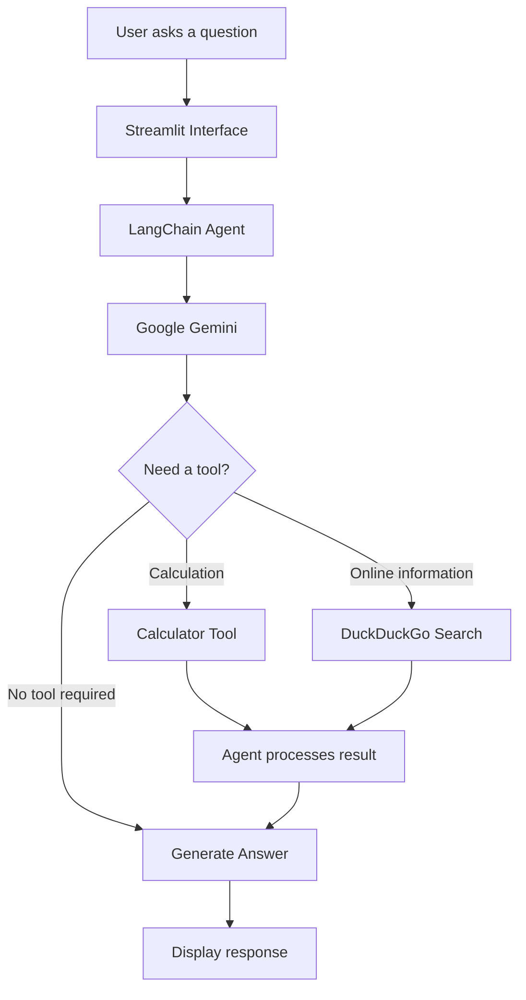

# AI Research Assistant Agent 🤖

An AI-powered research assistant built with Python, LangChain, Google Gemini, and Streamlit. The agent can answer questions, perform calculations, and search the web using tools based on the user's request.

## ✨ Features

- **AI-powered answers:** Uses Google Gemini to understand questions and generate responses.
- **Calculator tool:** Performs mathematical calculations.
- **Web search:** Uses DuckDuckGo search to retrieve relevant online information.
- **Interactive chat interface:** Built with Streamlit for a simple, user-friendly experience.
- **Conversation history:** Maintains chat history during the session.
- **Clear Chat:** Allows users to reset the current conversation.
- **Modular code:** Separates the interface, agent logic, and tools into individual Python files.

## 🛠️ Tech Stack

- Python
- Google Gemini API
- LangChain
- Streamlit
- DuckDuckGo Search
- python-dotenv

## 🏗️ Project Architecture

```text
AI-Research-Assistant-Agent/
│
├── app.py              # Streamlit chat interface
├── agent.py            # Gemini agent and tool integration
├── tools.py            # Calculator and web search tools
├── requirements.txt    # Project dependencies
├── .gitignore          # Excluded files and folders
├── .env                # API key (not committed)
└── README.md           # Project documentation
```

### How It Works



## ⚙️ Installation and Setup

### 1. Clone the repository

```bash
git clone https://github.com/PrernaPalsapure/AI-Research-Assistant-Agent.git
cd AI-Research-Assistant-Agent
```

### 2. Create a virtual environment

```bash
python -m venv myenv
```

Activate it on Windows PowerShell:

```powershell
.\myenv\Scripts\Activate.ps1
```

### 3. Install dependencies

```bash
python -m pip install -r requirements.txt
```

### 4. Configure your API key

Create a `.env` file in the project root and add your Google Gemini API key:

```env
GOOGLE_API_KEY=your_gemini_api_key_here
```

Get an API key through [Google AI Studio](https://aistudio.google.com/).

**Security:** Never commit your `.env` file or expose your API key publicly.

### 5. Run the application

```bash
streamlit run app.py
```

Open the local URL displayed in your terminal to start chatting with the assistant.

## 💬 Example Questions

Try asking the assistant:

- What is artificial intelligence, and how does it differ from machine learning?
- Calculate the compound interest on ₹10,000 at 8% annually for 3 years.
- Search the web for recent developments in generative AI.
- Explain how a large language model works in simple terms.

## 🎯 Learning Outcomes

This project provides practical experience with:

- Building an LLM-powered application.
- Integrating tools into an AI agent.
- Using LangChain with a Google Gemini model.
- Creating an interactive application with Streamlit.
- Managing conversation state and environment variables.
- Organizing Python projects into reusable modules.

## 🔮 Future Improvements

- Add document-based question answering using RAG.
- Add source links and improved search-result summaries.
- Introduce more tools for research and data analysis.
- Deploy the application for public access.
- Add automated tests and improved error handling.

## 👩‍💻 Author

**Prerna Anant Palsapure**

AI/ML Engineer | Python | Machine Learning | Generative AI | LLMs

[GitHub Profile](https://github.com/PrernaPalsapure)

---

*Built as a hands-on project to explore AI agents, LLMs, and tool integration.*
